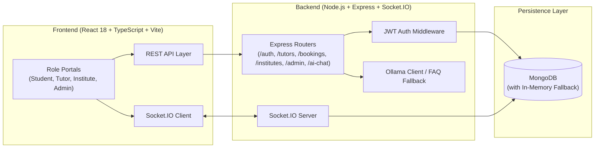

<div align="center">

  

  <p align="center">
    <b>A full-stack educational tutoring marketplace connecting students, qualified tutors, and academic institutes with smart search, booking management, real-time Socket.IO chat, brain quizzes, and an AI support assistant.</b>
  </p>

  <p align="center">
    <a href="https://tutor-booking-system-eight.vercel.app" target="_blank"></a>
  </p>

  <p align="center">
    
    
    
    
    
    <a href="LICENSE"></a>
  </p>

</div>

---

## Core Platform Capabilities

| Role / Module | Features |
| :--- | :--- |
| **Student Experience** | Filter tutors by subject, grade, teaching medium, class type & format; book sessions; track booking status & payments; rate tutors; take interactive brain quizzes. |
| **Tutor Portal** | Multi-step onboarding & verification workflow; manage subjects, hourly rates, timetables & learning materials; accept/reject booking requests; subscription plans & earnings dashboard. |
| **Real-Time Messaging** | Chat-request approval flow and instant bidirectional messaging powered by **Socket.IO**. |
| **Institute Management** | Create and manage educational institutes, assign tutors, configure institute timetables, and handle join requests. |
| **Admin Dashboard** | Approve/reject tutor profile requests, manage subjects, quizzes, user accounts, reviews, and financial records. |
| **AI Support Assistant** | Conversational help desk integrated via `/api/ai-chat` supporting local **Ollama** (`llama3.2`) with an automatic built-in FAQ fallback. |

---

## System Architecture



<details>
<summary><b>Project Structure</b></summary>

```text
Tutor-Booking-System/
├── Backend/
│   ├── config/mongodb.js      # MongoDB connection with in-memory fallback
│   ├── data/                  # Sample seed datasets & role organizers
│   ├── middleware/auth.js     # JWT authentication middleware
│   ├── routes/                # auth, tutors, bookings, chat, institutes, admin, ai-chat, subscription, users
│   ├── utils/notifications.js
│   ├── .env.example
│   └── server.js              # Express + Socket.IO entry point
├── Frontend/
│   ├── src/app/
│   │   ├── components/        # Chatbot widget, UI primitives & admin components
│   │   ├── contexts/          # Auth, ChatAuth, Theme & TutorOnboarding contexts
│   │   ├── pages/             # 35+ role-based pages & workflows
│   │   └── utils/             # REST & Socket.IO service wrappers
│   └── package.json
└── LICENSE
```

</details>

---

## Local Development Setup

### Prerequisites
- **Node.js 18+** and **npm**
- **MongoDB** (optional — if unreachable, the backend automatically starts with an in-memory database seeded from `Backend/data/json/`)

### 1. Clone the Repository
```bash
git clone https://github.com/Sh3hann/Tutor-Booking-System.git
cd Tutor-Booking-System
```

### 2. Start the Backend API
```bash
cd Backend
npm install
cp .env.example .env
npm run dev
```
The API and Socket.IO server will start on **http://localhost:3001**.

### 3. Start the Frontend Client
Open a second terminal:
```bash
cd Frontend
npm install
npm run dev
```
Open **http://localhost:5173** in your browser.

---

## Demo Accounts

Default credentials seeded for local testing (after running `Backend/clear-and-reload.js` or initial JSON load):

| Role | Email | Password |
| :--- | :--- | :--- |
| **Student** | `student@gmail.com` | `password123` |
| **Tutor** | `tutor@gmail.com` | `password123` |
| **Admin** | `admin@gmail.com` | `admin@gmail.com` |

---

## License

Released under the [MIT License](LICENSE) © 2026 [Akil Shehan](https://github.com/Sh3hann).

<div align="center">

<a href="https://itzshehan.xyz/"></a>
<a href="https://www.linkedin.com/in/akil-shehan"></a>
<a href="https://github.com/Sh3hann"></a>

</div>
